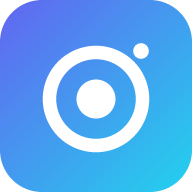

<p align="center">
  
</p>

<h1 align="center">CellDesk</h1>

<p align="center">
  Take a photo on your phone. It's on your PC a second later, in original quality.<br>
  iPhone and Android · Windows, macOS and Linux · no app store, no cables, no Bluetooth.
</p>

---

## Why

Sending a photo to your own computer usually means a messenger that compresses
it, a cloud drive that takes a minute to sync, or a cable. CellDesk keeps it to one tap:

- **Original quality.** The file goes over byte-for-byte: no re-encoding,
  no resizing, EXIF kept. The PC checks every file with SHA-256 before saving it,
  and the phone shows **✓ verified**.
- **Fast.** On the same Wi-Fi the phone talks straight to the PC.
- **Works from anywhere.** With the optional relay, your phone can send from
  mobile data or another country. Files are end-to-end encrypted
  (AES-256-GCM). The relay only passes along encrypted bytes and keeps nothing.
- **Nothing gets lost.** If the PC is off, photos wait on the phone and go out
  on their own once it's back.
- **No app store.** The phone side is a web app you add to your home screen.
  It works the same on iPhone and Android.

## How it works

```
                 same Wi-Fi: direct HTTP
   ┌────────┐ ─────────────────────────────▶ ┌──────────────┐
   │ Phone  │                                 │ CellDesk on  │──▶ Pictures/CellDesk
   │ web app│ ──HTTPS──▶ ┌──────────────┐ ──▶ │ your PC      │
   └────────┘  anywhere  │ your relay   │ WSS └──────────────┘
                         │ (Cloudflare) │  (PC connects out, so no
                         └──────────────┘   port forwarding needed)
```

The protocol is described in [docs/PROTOCOL.md](docs/PROTOCOL.md).

## Quick start (same Wi-Fi)

1. Download CellDesk for your computer from
   [Releases](https://github.com/Loseless02/celldesk/releases/latest) and unzip it.
2. Run `celldesk` (`celldesk.exe` on Windows). Your browser opens the dashboard
   with a QR code.
   - **Windows:** if Windows asks, allow CellDesk on **private networks**.
     SmartScreen may warn about an unsigned app: click *More info → Run anyway*.
   - **macOS:** the first time, right-click → *Open* (or run
     `xattr -d com.apple.quarantine celldesk`).
3. Scan the QR code with your phone's camera and open the link.
4. Add it to your home screen so it opens like an app:
   - **iPhone (Safari):** Share → *Add to Home Screen*
   - **Android (Chrome):** ⋮ → *Add to Home screen* / *Install app*
5. Tap the big shutter button, take a photo, tap *Use Photo*. It's on your PC.

The bottom bar on the phone:

| Button | What it does |
| --- | --- |
| **Gallery** | Send photos and videos from the photo library |
| **Files** | Send any file (PDFs, documents, zips…) from the phone's files |
| **Shutter** | Take a photo with the phone camera and send it at full quality |
| **Scan** | Scan documents: finds the page, lets you fix the corners, straightens it, removes shadows, and sends all pages as one PDF |
| **Queued** | Files waiting for the PC; tap to retry now |

**PC → phone:** drop files on **Send to phone** in the dashboard. An inbox
icon with a badge appears on the phone: tap **Get** (downloads and checks
SHA-256), then **Save** (iPhone share sheet → *Save Image* / *Save to Files*;
Android downloads). Files stay available until you remove them on the PC.

Photos land in `Pictures/CellDesk` by default. You can change the folder in the dashboard.
To open the dashboard again, run CellDesk again (it won't start twice) or go to
<http://localhost:47474>.

**Run it in the background:** turn on *Start CellDesk when I log in* in the
dashboard. There's no console window; CellDesk lives in the tray (Windows
notification area, Linux status area). Click the icon to open the dashboard,
right-click for *Open received folder* and *Quit CellDesk*.

**Stop it** (closes port 47474) any of these ways:

- Tray icon → *Quit CellDesk*
- Dashboard → Settings → *Quit CellDesk*
- `celldesk --quit` from a terminal (also the way on macOS, which has no tray icon)

## Send from anywhere, privately (Tailscale)

No website, nothing public: [Tailscale](https://tailscale.com/download) puts
your phone and PC on a private encrypted network that only devices you approve
can join. Both sides only make outbound connections, so there's nothing to
forward on your router.

1. Install Tailscale on the PC and on the phone and sign in with the same account.
2. In the dashboard, open **Pair a phone → Private** and scan the QR code.
3. Keep Tailscale switched on on the phone. That pairing works at home and away.

To let a friend send you photos, invite them to your tailnet
(Tailscale admin console → Users → Invite) and show them the QR code. They
still need the code: being on the tailnet alone isn't enough.

## Send from anywhere without an extra app (relay)

If you'd rather not run a VPN app on the phone, deploy your own relay to
Cloudflare once. The free plan covers it: no card, no server to run. The relay
URL is public, but it only serves the empty app shell; without a QR code nobody
can send anything, and files are end-to-end encrypted.

```bash
cd relay
npm install
npx wrangler login
npx wrangler deploy
```

Wrangler prints a URL like `https://celldesk-relay.<you>.workers.dev`.
Paste it into the dashboard under **Pair a phone → Anywhere → Save**, then scan
that QR code with your phone. Use this pairing on the phone: it works at home too.

<details>
<summary>Deploy from GitHub instead</summary>

Add the `CLOUDFLARE_API_TOKEN` (template *Edit Cloudflare Workers*) and
`CLOUDFLARE_ACCOUNT_ID` repository secrets, then run **Actions → Deploy relay**.
</details>

| | Same Wi-Fi | Private (Tailscale) | Anywhere (relay) |
| --- | --- | --- | --- |
| Setup | none | Tailscale app on PC + phone | deploy relay once |
| Public URL | no | no | yes (useless without QR code) |
| Speed | LAN speed | near LAN at home, upload speed away | your phone's upload speed |
| Encryption | none (your own network) | WireGuard | end-to-end AES-256-GCM |
| Max file size | unlimited | unlimited | 95 MB per file |

## Quality notes

- **Photos taken in CellDesk** use the phone's own camera app at full resolution,
  and that exact file is sent.
- **iPhone gallery picks:** when you pick a HEIC photo from the library, iOS may
  hand Safari a full-resolution JPEG copy before CellDesk ever sees the file. To
  make sure library picks arrive untouched, set
  *Settings → Camera → Formats → Most Compatible*. The camera then saves JPEG to
  begin with, so iOS has nothing to convert.
- Videos work too (gallery button). Large videos are best sent on the same Wi-Fi.

## Security

- **Same Wi-Fi:** the QR code holds a random token. Without it, other devices on
  your network can't upload. Only your own computer can open the dashboard and its
  settings, and it's protected against DNS rebinding and cross-site requests.
- **Anywhere:** the QR code holds a room ID and a 256-bit encryption key. The key
  stays in the URL fragment, which the browser never sends to the relay. The PC
  proves it owns its room with its own secret key. Without the key, the relay
  can't read or change your files.
- Lost your phone? Go to **Dashboard → Settings → Unpair phones**.

Treat the QR code like a password: anyone who scans it can send files to your PC.

## Build from source

Requirements: Go 1.26+. Node 20+ for the relay.

```bash
go test ./...
go build -o celldesk ./cmd/celldesk
```

Windows build without a console window:

```bash
go build -ldflags "-H=windowsgui" -o celldesk.exe ./cmd/celldesk
```

Run the relay locally with `cd relay && npx wrangler dev`, then start the desktop
app with `celldesk --relay http://localhost:8787`. Set `CELLDESK_HOME` to keep a
separate config while testing.

Regenerate the PNG icons after editing the design with
`go run tools/genicons/main.go`.

## Releasing

Push a tag. GitHub Actions tests, builds Windows/macOS/Linux (amd64 and arm64),
and publishes a release with checksums:

```bash
git tag v0.1.0
git push origin v0.1.0
```

## Project layout

```
cmd/celldesk/     desktop entry point
internal/app/     receiver: HTTP server, relay client, saving, settings
dashboard/        desktop dashboard (embedded)
phone/            phone web app (embedded in the desktop app, served by the relay)
relay/            Cloudflare Worker + Durable Object relay
docs/PROTOCOL.md  wire formats
```

## Roadmap

- Tray icon and native notifications
- Direct peer-to-peer (WebRTC) when the phone is remote, with the relay only as a fallback
- Multiple PCs per phone
- Push notification on the phone when the PC sends something

## License

[MIT](LICENSE)
